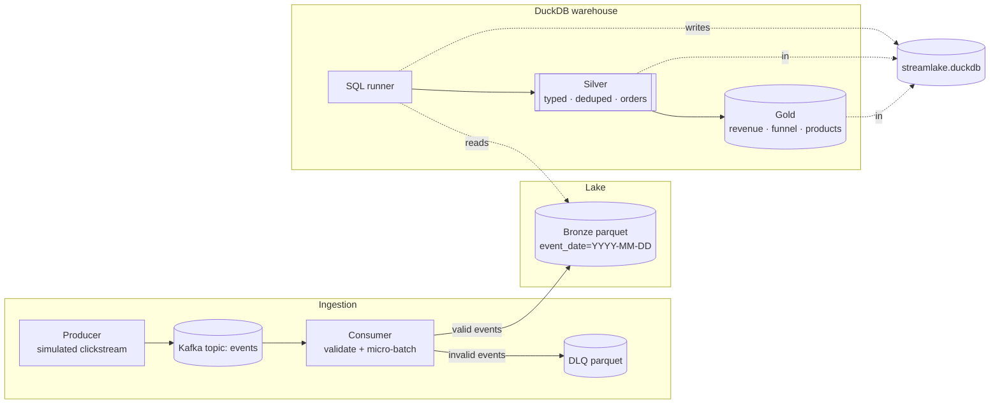

# streamlake

[](https://github.com/KhalidKhan541/streamlake/actions/workflows/ci.yml)
[](LICENSE)
[](https://www.python.org/downloads/)

A **real-time lakehouse** for e-commerce clickstream data: Kafka ingestion,
pydantic event contracts, an immutable Parquet **bronze** layer, a dead-letter
queue for bad records, and **silver/gold** models built with plain SQL in
**DuckDB**.

It is designed like a small production pipeline and still runs in one command:
`streamlake demo` exercises the entire flow (contracts → bronze → DLQ →
transform → gold tables) **without needing Kafka**.

## Highlights

- **Streaming ingestion with micro-batches** — size- and time-based flushes,
  offsets committed **only after** data is durably written.
- **Event contracts** — every event is validated with pydantic v2
  (discriminated union, extra fields forbidden, order totals reconciled).
- **Dead-letter queue** — invalid JSON or schema violations land in
  `lake/dlq/` with the original payload and the validation error; the consumer
  keeps going.
- **Effectively-once** — at-least-once delivery plus `event_id` deduplication
  in the silver layer. Replays and retries are safe by construction.
- **Medallion SQL models** — typed + deduplicated events, order lifecycle
  reconstruction, revenue, funnel and product performance — all readable SQL,
  no dbt required.
- **Operational visibility** — `ops_model_runs` records every model run
  (rows, duration); `streamlake stats` prints layer sizes.
- **Kafka-free demo + integration tests** — the whole pipeline is testable on
  a laptop or in CI with no broker.

## Architecture



- **Bronze** is append-only raw history: one Parquet file per micro-batch,
  partitioned by event date, with `payload` stored as JSON.
- **Silver** deduplicates by `event_id`, parses payloads, and rebuilds order
  state from `order_placed` / `payment_processed` / `order_cancelled` events.
- **Gold** tables are recomputed from silver on every transform run — safe to
  rebuild at any time.

## Quickstart A — full demo in ~60 seconds (no Kafka)

```bash
git clone https://github.com/KhalidKhan541/streamlake.git
cd streamlake
python -m venv .venv
# Windows: .venv\Scripts\activate
source .venv/bin/activate
pip install -r requirements-dev.txt
pip install -e .

streamlake demo --events 3000 --seed 42
```

The demo generates a simulated clickstream (with a small slice of deliberately
invalid events), validates them, writes bronze + DLQ Parquet files, runs all
SQL models, and prints the resulting tables. Then explore:

```bash
streamlake query "select * from gold_daily_revenue order by order_date desc"
streamlake query "select * from gold_funnel"
streamlake stats
```

## Quickstart B — real Kafka end-to-end

Prereqs: Docker Desktop with Compose v2.

```bash
docker compose up -d kafka kafka-ui     # broker + UI (http://localhost:8080)
docker compose up -d processor          # consumer (micro-batches + transform every 2 flushes)
docker compose run --rm processor produce --rate 40 --duration 30
```

Inspect the results (all commands run inside the same image and share the
`lake/` + `warehouse/` volumes):

```bash
docker compose run --rm processor query "select * from gold_funnel"
docker compose run --rm processor query "select * from gold_product_performance limit 10"
docker compose run --rm processor stats
```

Prefer working from your host? Point the CLI at the broker and run it there:

```bash
streamlake produce --rate 40 --duration 30
streamlake consume --transform-every 2
```

## Event contract

Every message is one JSON object. Example `order_placed` event:

```json
{
  "event_id": "evt_2a_00000042",
  "event_type": "order_placed",
  "event_ts": "2026-10-30T11:24:05+00:00",
  "user_id": "u_0071",
  "session_id": "s_2a_000031",
  "order_id": "ord_2a_000031",
  "items": [
    { "product_id": "P004", "quantity": 1, "unit_price": 129.0 },
    { "product_id": "P002", "quantity": 2, "unit_price": 49.5 }
  ],
  "total": 228.0,
  "currency": "USD"
}
```

Supported event types:

| Event | Purpose |
| --- | --- |
| `page_view` | funnel entry (`page`, `device`) |
| `add_to_cart` | intent (`product_id`, `quantity`, `unit_price`) |
| `order_placed` | checkout (`order_id`, `items`, `total`) |
| `payment_processed` | order becomes revenue (`order_id`, `amount`, `method`) |
| `order_cancelled` | order lifecycle (`order_id`, `reason`) |

Validation rules include: timezone-aware timestamps, positive quantities and
prices, non-empty order items, `extra="forbid"`, and order `total` must match
the sum of line items.

## Data model

| Layer | Table | Grain / purpose |
| --- | --- | --- |
| silver | `silver_events` | one row per `event_id`; typed columns extracted from JSON |
| silver | `silver_order_items` | one row per order line (items exploded from `order_placed`) |
| silver | `silver_orders` | one row per order with reconstructed lifecycle status (`paid` / `pending` / `cancelled`) |
| gold | `gold_daily_revenue` | revenue and AOV per day over paid orders |
| gold | `gold_funnel` | daily session funnel + conversion rates |
| gold | `gold_product_performance` | units and gross revenue per product |
| ops | `ops_model_runs` | run history of every SQL model (rows + duration) |

## Delivery semantics

1. The consumer polls messages with `enable.auto.commit=false`.
2. Valid events are written to an immutable Parquet file; invalid ones go to
   the DLQ — both durably on disk.
3. **Only then** are Kafka offsets committed.
4. Silver deduplicates by `event_id`.

If the process dies at any point, messages are redelivered and the duplicate
rows are collapsed by the dedupe step. That is at-least-once delivery with
idempotent processing — effectively-once data in the warehouse.

## Configuration

| Variable | Default | Purpose |
| --- | --- | --- |
| `STREAMLAKE_KAFKA_BOOTSTRAP` | `localhost:29092` | broker address |
| `STREAMLAKE_TOPIC` | `events` | input topic |
| `STREAMLAKE_GROUP_ID` | `streamlake-ingest` | consumer group |
| `STREAMLAKE_LAKE_DIR` | `<repo>/lake` | bronze + DLQ root |
| `STREAMLAKE_WAREHOUSE` | `<repo>/warehouse/streamlake.duckdb` | DuckDB database |
| `STREAMLAKE_SQL_DIR` | `<repo>/sql` | SQL model directory |
| `STREAMLAKE_BATCH_SIZE` | `500` | max messages per flush |
| `STREAMLAKE_FLUSH_SECONDS` | `5` | max seconds between flushes |

## Project layout

```
├── src/streamlake/
│   ├── config.py        # env-driven settings
│   ├── events.py        # event contracts + deterministic simulator
│   ├── bronze.py        # Parquet bronze + DLQ writers
│   ├── producer.py      # Kafka producer
│   ├── consumer.py      # validate → bronze/DLQ → commit → transform cadence
│   ├── transform.py     # DuckDB SQL model runner
│   ├── warehouse.py     # read-only helpers for querying
│   ├── demo.py          # Kafka-free end-to-end pipeline
│   └── cli.py           # `streamlake` command
├── sql/                 # numbered medallion models (silver → gold)
├── tests/               # unit + end-to-end tests (real DuckDB)
├── notebooks/           # exploration on the gold tables
├── docs/architecture.md
├── docker-compose.yml   # Kafka (KRaft) + Kafka UI + processor
├── Dockerfile
└── Makefile
```

## Testing

```bash
pytest            # unit + end-to-end demo tests, no broker required
ruff check src tests
```

CI runs lint, the full test suite (including a real DuckDB transform), a CLI
demo smoke test, and `docker compose config` validation on every push.

## Notes & trade-offs

- **Single-writer DuckDB.** The consumer runs transforms in-process; run
  ad-hoc `streamlake transform`/`query` from another process only when it is
  not transforming at that moment. Fine for a dev lakehouse; swap the sink for
  ClickHouse/BigQuery at scale.
- **JSON payloads in bronze** keep the raw contract flexible; schema
  enforcement happens at ingest (pydantic) and again in silver (typed SQL).
- **Local filesystem lake.** The writer only needs a filesystem path to target
  S3/GCS-style object storage later.

## Roadmap

- [ ] Schema registry + Avro/Protobuf serialization
- [ ] Kafka transactions / exactly-once producer-consumer
- [ ] Incremental SQL models with watermarks
- [ ] Object-store bronze (S3/GCS) and table format (Iceberg/Delta)
- [ ] Prometheus metrics endpoint + Grafana dashboard

## License

[MIT](LICENSE)
